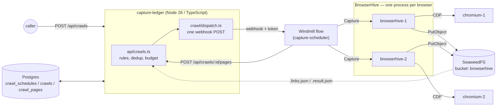
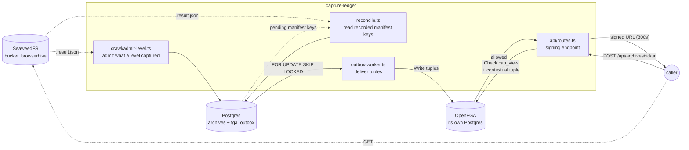

## Stage 0 — where the project is today

## From submission to outcome

**capture-ledger does not talk to BrowserHive at all.** The Windmill flow calls
`POST /captures`, waits for the answer, and reports; capture-ledger plans the next
level and records what happened. There is no BrowserHive address in capture-ledger's
configuration at all. Each BrowserHive drives one browser and runs one capture at
a time — a busy one refuses with `429 Busy` — so picking a free endpoint is the
flow's job too.

One level is one round trip. The flow captures the URLs it was handed and posts
`POST /api/crawls/:id/pages` with a `taskId` and a status per page. capture-ledger writes
`crawl_pages`, attributes the submissions, filters the discovered links, applies
the budget, and answers with the next level — or with a `stopReason`.

The level report does **not** carry artifact locations. It carries only where
BrowserHive (or the sink) wrote the `.result.json` manifest next to the artifacts,
so capture-ledger re-reads the manifest **at the reported location** — it never
assembles a file name to look for. That file survives a BrowserHive restart, which is
what makes it usable here. The capture's log is in that file too, and capture-ledger
copies only its counts into `crawl_pages` ([Pages and their capture logs](/capture-ledger/archive-ledger/#pages-and-their-capture-logs)).

Consequences worth knowing:

- **The manifest wins over the reported status.** The manifest of a page reported
  `failed` is read too, and if it says the capture succeeded, capture-ledger admits it
  and corrects the `crawl_pages` row. BrowserHive now writes the manifest before it
  answers, in one round trip, and the answer's report is the same content, so the two
  hardly ever disagree — this is a guard for when the report and the record drift apart.
- **A capture cut by the flow's deadline cannot be picked up.** The flow never got the
  answer, so the report carries neither a `taskId` nor a manifest location. The manifest
  BrowserHive wrote may be in the bucket, but nothing in the ledger leads to it.
- A manifest that is not there yet is skipped rather than raised. Throwing would
  turn a late write into a 500 on the level report, stopping the crawl; the
  reconciler picks it up instead.
- `capture_submissions` is written for **every** page that carried a `taskId`,
  not only the successful ones — attribution and the manifest key are what the
  reconciler later needs.

## The ledger and authorization

The diagram above stops at **submitting**. Once a capture finishes, capture-ledger puts
the result in the ledger and hands out signed URLs only to those allowed to read
it. That is where OpenFGA comes in.

How to read it:

- **`archives` and `fga_outbox` are written in one transaction.** No transaction
  spans Postgres and OpenFGA, so the tuple goes into the same box as an intent to
  send, and `outbox-worker` retries until OpenFGA accepts it.
- **OpenFGA has a Postgres of its own.** Not sharing capture-ledger's makes the boundary
  visible: a tuple write cannot join the application transaction — which is
  exactly why the outbox exists.
- **Membership is not stored.** Which organizations a caller belongs to arrives
  from their token and is passed as a contextual tuple on every Check.
- Two paths lead into the ledger: a **crawl** admitting what a level captured
  (fast, `src/crawl/admit-level.ts`), and `reconcile` reading the manifest keys the
  level reports recorded (picks up what the fast path failed to admit). Both go through `admitArchive`, and
  `(bucket, object_key)` is unique, so reaching the same capture twice is a no-op.

See [Archive ledger](/capture-ledger/archive-ledger/) for the details.

## Module layout

| Module                          | Responsibility                                                                                                                                                                                               |
| ------------------------------- | ------------------------------------------------------------------------------------------------------------------------------------------------------------------------------------------------------------ |
| `src/api/server.ts`             | The only entry point. Reads the capture settings once, registers the routes, drains the outbox on a timer.                                                                                                   |
| `src/api/crawls.ts`             | Start a crawl, report a level, hand back the next one. Authorization, policy, and record-keeping.                                                                                                            |
| `src/crawl/`                    | Scope, budget, level admission, and the Windmill dispatch.                                                                                                                                                   |
| `src/config/capture-formats.ts` | `CAPTURE_LEDGER_CAPTURE_FORMATS` / `_SIGNING` → the `captureFormats` every dispatch carries.                                                                                                                 |
| `src/schedules/`                | The clock: cron, the health words, and the tick that starts a crawl when a schedule falls due.                                                                                                               |
| `src/archive/`                  | Manifests, admission into the ledger, and the reconciler.                                                                                                                                                    |
| `src/rpc/generated/`            | BrowserHive's contract (`openapi.json`, copied from the submodule) and the types made from it. The manifest is a `CaptureResultReport`, checked against it before the ledger reads it. Never edited by hand. |
| `src/db/`                       | Pool, Kysely wiring, migrations.                                                                                                                                                                             |

## Error handling

Telling a rejection apart from an outage is the flow's job now — it is the side
that calls BrowserHive. capture-ledger's half is what happens to the `crawls` row.

A dispatch that cannot be delivered does not leave the row `running`: the ledger closes it
as `failed` with the message on it, because an unclosed row blocks every later crawl through
the partial unique index. Once a level has been handed to Windmill, only the reports close the
row ([How a crawl row ends](/capture-ledger/archive-ledger/#how-a-crawl-row-ends)).

Unexpected failures on the API surface as a bare `500 { "error": "internal
error" }`. Fastify's default would return `err.message` and `err.code`, and
Postgres puts column types and mangled values in there — a client-side mistake
would become a window onto the server's internals. 4xx bodies pass through
unchanged: those are written for the caller.

## Network layout

The stack runs on Apple Container. The project name is the DNS domain, so every
service is `<service>.capture-ledger`, and the containers reach each other by that name.
capture-ledger itself runs on the host and uses the host ports below (published on `127.0.0.1`).

| Service        | DNS name                       | Container port | Host port |
| -------------- | ------------------------------ | -------------- | --------- |
| postgres       | `postgres.capture-ledger`      | 5432           | 5432      |
| chromium-1     | `chromium-1.capture-ledger`    | 9222 (CDP)     | 9222      |
| chromium-2     | `chromium-2.capture-ledger`    | 9222 (CDP)     | 9223      |
| browserhive-1  | `browserhive-1.capture-ledger` | 50051 (HTTP)   | 50051     |
| browserhive-2  | `browserhive-2.capture-ledger` | 50051 (HTTP)   | 50052     |
| capture-ledger | — (runs on the host)           | —              | —         |

The artifact store (SeaweedFS) is **not in this stack**. It is one store shared by the
[Web Capture](https://uraitakahito.github.io/capture-ledger/#web-capture) repos, at `seaweedfs.crawler-storage:8333` (filer on `:8888`). It is brought up by
[seaweedfs](https://github.com/uraitakahito/seaweedfs)'s `scripts/stack.sh` — the submodule works
too: `.upstream/seaweedfs/scripts/stack.sh up`. To empty it, `pnpm run store:wipe`.

There is one compose file. The one-shot migrate job is not a service:
`dev:up` runs it on the host (`pnpm run db:migrate`), because
container-compose has no `run` subcommand. The image's `ENTRYPOINT` is
`node dist/api/server.js`, so running it from the image means overriding it.

Bucket creation is **not** a separate service. BrowserHive's SeaweedFS entrypoint
spawns its `init-bucket.sh` alongside `weed server`, and its retry loop does the
waiting. `browserhive` is given `WAIT_FOR_S3`; its entrypoint polls that URL
until the S3 listener answers before starting the server, because the boot
`HeadBucket` is fatal and `depends_on` orders starts only.

## Upstream pinning

capture-ledger tracks a fixed BrowserHive version through one submodule pointer — see
[Upgrading BrowserHive](/capture-ledger/upgrading-browserhive/), which reads the current
value out of the repository rather than restating it.
