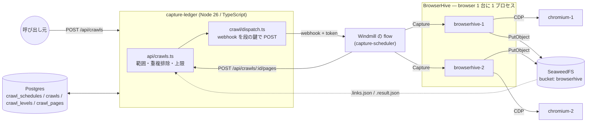
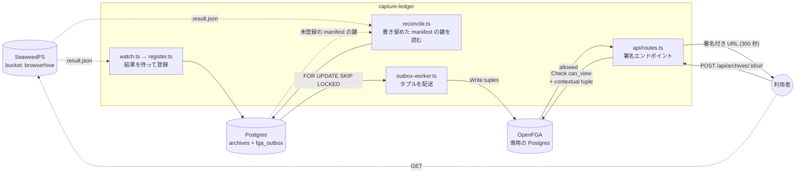

## Stage 0 — 現在の到達点

## 投げてから、結末を回収するまで

**capture-ledger は BrowserHive とまったく話しません。** `POST /captures` を呼んで答えを
待ち、報告するのは Windmill の flow で、capture-ledger は次の段を組み立てて記録します。
capture-ledger の設定に BrowserHive の在り処は 1 つも入っていません。BrowserHive は
1 プロセスが browser 1 台を持ち、取り込みは 1 度に 1 つ —— 走行中なら
`429 Busy` で断る —— ので、空いているエンドポイント（BrowserHive の宛先 URL）を選ぶのも flow の仕事です。

1 段が 1 往復です。flow は渡された URL を取り込み、`POST /api/crawls/:id/pages` に
ページごとの `taskId` と状態を載せて返します。capture-ledger は `crawl_pages` を書き、
帰属を記録し、見つかったリンクを範囲で絞り、上限を当て、次の段を答えます ——
あるいは `stopReason` を返します。

**段は鍵で 1 回にします（CAPTURE-180）。** capture-ledger は段を決めたときに段の行（`crawl_levels`）を作り、Windmill の job の id を
乱数で決めて持ちます。webhook には `?job_id=` で付け、flow には `level_key` の引数で渡します。Windmill は在る id の 2 本目を 400 で
断るので、時間切れの後に同じ id で送り直しても flow は 1 本です。その場で 3 回、それでも受け取りを確かめられなければ投げる係の時計
（30 秒ごと）が送り直し、段の行を作ってから 10 分で諦めてクロールを `failed` で締めます。段の報告は `Idempotency-Key` にこの鍵を
付け、同じ段の 2 回目には最初の答えが返ります（[段の鍵](/capture-ledger/ja/archive-ledger/#段の鍵)）。

段の報告に**成果物の在り処は載っていません**。載っているのは、
BrowserHive（または受け取り先）が成果物の隣に `.result.json`（manifest）を書いた場所だけです。そこで
capture-ledger は、**報告された場所のとおりに** manifest を読み直します ——
名前を組み立てて探すことはしません。この file は BrowserHive の再起動にも耐えるので、
ここで使えます。取り込みのログもこの file に在り、capture-ledger はその数だけを `crawl_pages`
に写します（[ページと取り込みのログ](/capture-ledger/ja/archive-ledger/#ページと取り込みのログ)）。

知っておくべき帰結:

- **報告の状態より manifest を採ります。** `failed` と報告されたページの manifest も読み、
  成功を語っていれば `archives` に入れて `crawl_pages` の記録を直します。いまの BrowserHive は manifest
  を書き終えてから 1 往復で答え、答えの report と manifest は同じ中身なので、
  食い違うことはまずありません —— 報告と正本がずれたときの備えです。
- **flow の deadline で切った取り込みは拾えません。** flow は答えを受け取っていないので、
  `taskId` も manifest の場所も報告に載りません。BrowserHive が書いた manifest は bucket に在っても、
  capture-ledger からは辿れません。
- まだ manifest が無い `taskId` は、投げずに飛ばします。ここで投げると、書き込みが
  少し遅れただけで段の報告が 500 になり、クロールが止まります。遅れたぶんは
  reconcile が拾います。
- `capture_submissions` は `taskId` を持つ**全件**に書きます（成功したものだけでは
  ありません）。後で reconciler が要るのは、まさにこの帰属と manifest の鍵です。

## 記録と認可

上の図は**投げるところまで**です。取り込みが終わったあと、capture-ledger は結果を自分の DB に
入れ、それを読んでよい相手だけに署名付き URL を配ります。ここが OpenFGA の
出番です。

読み方の要点:

- **`archives` と `fga_outbox` は 1 つのトランザクションで書かれます。**
  Postgres と OpenFGA に跨がるトランザクションが無いので、タプルは「送る予定」として
  同じ箱に入れ、`outbox-worker` が受理されるまで再送します。
- **OpenFGA は別の Postgres を持ちます。** capture-ledger のものと共用しないのは、
  タプルの書き込みがアプリのトランザクションに入れられないこと ——
  だから outbox が要ること —— を目に見えるようにするためです。
- **所属は保存しません。** 「この人はどの組織か」はトークンから来て、Check のたびに
  contextual tuple として渡されます。
- アーカイブの記録へ入る道は 2 本あります。**クロール**が段で取り込んだぶんを載せる経路
  （速い。`src/crawl/admit-level.ts`）と、`reconcile` が段の報告の書き留めた manifest の鍵を
  読む経路（速い経路で入らなかったものを拾う）。どちらも `admitArchive` を通り、
  `(bucket, object_key)` が unique なので、同じ取り込みに 2 度届いても増えません。

詳しくは[アーカイブの記録](/capture-ledger/ja/archive-ledger/)を参照してください。

## モジュール構成

| モジュール                      | 責務                                                                                                                                                                         |
| ------------------------------- | ---------------------------------------------------------------------------------------------------------------------------------------------------------------------------- |
| `src/api/server.ts`             | 唯一の入口。取り込みの設定を起動時に 1 度読み、route を登録し、outbox をタイマーで掃き出す。                                                                                 |
| `src/api/crawls.ts`             | クロールを始める / 段を受ける / 次の段を返す。認可・方針・記録。                                                                                                             |
| `src/crawl/`                    | 範囲、上限、段の取り込みの登録、Windmill への dispatch。                                                                                                                     |
| `src/config/capture-formats.ts` | `CAPTURE_LEDGER_CAPTURE_FORMATS` / `_SIGNING` を、毎回載せる `captureFormats` にする。                                                                                       |
| `src/schedules/`                | 時計。cron・状態の語と、予定の期限が来るとクロールを始める周回。                                                                                                             |
| `src/archive/`                  | manifest、`archives` への受け入れ、reconciler。                                                                                                                              |
| `src/rpc/generated/`            | BrowserHive の契約（submodule から写した `openapi.json`）と、そこから作った型。manifest は `CaptureResultReport` で、capture-ledger が読む前にこれに照らす。手で編集しない。 |
| `src/db/`                       | プール、Kysely の配線、マイグレーション。                                                                                                                                    |

## エラーの扱い

拒否と障害の見分けは、いまや flow の仕事です —— BrowserHive を呼んでいるのが
あちらだからです。capture-ledger の側の関心事は、`crawls` の行がどうなるかです。

投げられなかった dispatch は、`running` のまま置かず、その行をメッセージ付きの `failed` で締めます。
締め忘れた行は、部分 unique index のために以後のクロールを塞ぐからです。段を Windmill に渡した後に行を締めるのは
報告だけです（[クロールの行の終わり方](/capture-ledger/ja/archive-ledger/#クロールの行の終わり方)）。

API 側の予期しない失敗は、素の `500 { "error": "internal error" }` で返します。
Fastify の既定は `err.message` と `err.code` をそのまま返しますが、Postgres の
エラーはそこに列の型と値の成れの果てを載せてくるので、client 側の誤りが
**サーバ内部の形を教える窓**になります。4xx はそのまま通します —— あれは client に
向けて書かれた文言です。

## ネットワーク構成

スタックは Apple Container 上で動きます。プロジェクト名がそのまま DNS ドメインに
なるので、各サービスは `<service>.capture-ledger` で、コンテナどうしはこの名前で呼び合います。
capture-ledger 自身はホストで動き、下の表の「ホストポート」（`127.0.0.1` に publish したポート）を使います。

| サービス         | DNS 名                            | コンテナポート                     | ホストポート |
| ---------------- | --------------------------------- | ---------------------------------- | ------------ |
| postgres         | `postgres.capture-ledger`         | 5432                               | 5432         |
| chromium-1       | `chromium-1.capture-ledger`       | 9222 (CDP)                         | 9222         |
| chromium-2       | `chromium-2.capture-ledger`       | 9222 (CDP)                         | 9223         |
| browserhive-1    | `browserhive-1.capture-ledger`    | 50051 (HTTP)                       | 50051        |
| browserhive-2    | `browserhive-2.capture-ledger`    | 50051 (HTTP)                       | 50052        |
| openfga          | `openfga.capture-ledger`          | 8080 (HTTP)                        | 8090         |
| idp              | `idp.capture-ledger`              | 4566 (Floci)                       | 4566         |
| replayweb-server | `replayweb-server.capture-ledger` | 8080 (HTTP)                        | 8899         |
| capture-player   | `capture-player.capture-ledger`   | 8080 (HTTP)                        | 8897         |
| opensearch       | `opensearch.capture-ledger`       | 9200（profile `search`）           | 9200         |
| wacz-signer      | `wacz-signer.capture-ledger`      | 8080（profile `signing`）          | 18091        |
| capture-fixtures | `capture-fixtures.capture-ledger` | 8080（profile `capture-fixtures`） | 18085        |
| capture-ledger   | —（ホストで動く）                 | —                                  | 7070（API）  |

成果物ストア（SeaweedFS）は**このスタックには居ません**。[Web Capture](https://uraitakahito.github.io/capture-ledger/ja/#web-capture) の repo が
共有する 1 つの store で、`seaweedfs.crawler-storage:8333`（filer は `:8888`）です。
起こすのは [seaweedfs](https://github.com/uraitakahito/seaweedfs) の
`scripts/stack.sh`（submodule なので `.upstream/seaweedfs/scripts/stack.sh up` でも同じ）。
中身を空にしたいときは `pnpm run store:wipe`。

compose ファイルは 1 つです。migrate の一発ジョブはサービスではなく、
`dev:up` が host で走らせます（`pnpm run db:migrate`。container-compose に
`run` が無いため）。イメージの `ENTRYPOINT` は `node dist/api/server.js` なので、
イメージから走らせるときはそれを上書きします。

バケットの作成は**独立したサービスではありません**。BrowserHive の SeaweedFS
entrypoint が `weed server` と並行して `init-bucket.sh` を起動し、そのリトライ
ループが待機を担います。`browserhive` には `WAIT_FOR_S3` を渡してあり、
entrypoint が S3 リスナーの応答を待ってからサーバを起動します。起動時の
`HeadBucket` は fatal で、`depends_on` は起動順しか保証しないためです。

## 上流のピン留め

capture-ledger は submodule ポインタ 1 つで BrowserHive の版を固定しています。
[BrowserHive の更新](/capture-ledger/ja/upgrading-browserhive/)を参照してください
(そのページは現在の値をリポジトリから読んでおり、ここに再掲しません)。
